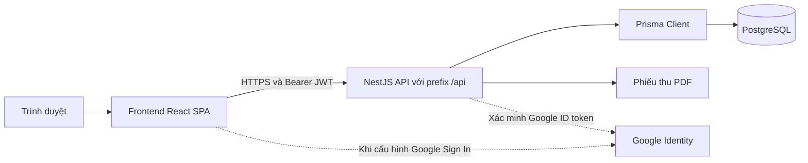

# Tài liệu bàn giao kỹ thuật và vận hành DreamHigh PMS

| Thông tin | Nội dung |
|---|---|
| Hệ thống | DreamHigh PMS — Quản lý đào tạo trung tâm tiếng Anh |
| Phiên bản tài liệu | v0.1 — Draft |
| Ngày lập | 23/10/2026 |
| Đối tượng tiếp nhận | Đội kỹ thuật tiếp nhận và vận hành |
| Bên bàn giao | [TBD] Đơn vị và người phụ trách |
| Bên tiếp nhận | [TBD] Đơn vị và người phụ trách |
| Phạm vi | Mã nguồn hiện tại, cấu hình, dữ liệu, kiểm thử, vận hành và công việc còn lại |
| Mốc mã nguồn | Nhánh `master`, commit `cd79cb2b37a7326a1366b87345512a7835ed8544`, kèm thay đổi chưa commit tại thời điểm khảo sát |
| Bản phát hành triển khai | [TBD] Tag hoặc commit đầy đủ sau khi chốt gói bàn giao |

Đội tiếp nhận dùng tài liệu này để dựng môi trường, xác định các thành phần cần bảo trì và hoàn tất điều kiện đưa hệ thống vào vận hành. Gói hiện tại có mã nguồn và hồ sơ triển khai; việc bàn giao production cần đóng các mục tại phần 10, xác nhận dữ liệu và ký biên bản tại phần 12.

Báo cáo Phase F ghi nhận PASS và sẵn sàng go-live. Tuy nhiên, working tree hiện tại còn các điểm chưa khớp với kết luận đó: cấu trúc CI, script UAT, hướng dẫn triển khai và mức hoàn thiện một số chức năng. Trạng thái bàn giao của tài liệu này là **dự thảo bàn giao kỹ thuật có hạng mục cần hoàn tất**; quyết định nghiệm thu cuối cùng thuộc các bên ký nhận.

## 1 Phạm vi và hồ sơ bàn giao

### 1.1 Danh mục tài sản

Các đường dẫn dưới đây tương đối với tài liệu này; bên tiếp nhận cần nhận cả thư mục con và các file chưa được Git theo dõi thuộc phạm vi đã thống nhất.

| Tài sản | Vị trí | Nội dung tiếp nhận |
|---|---|---|
| Frontend | [dreamhigh-web](../../dreamhigh-web/) | React SPA, màn hình, routing, design system, API client, browser tests |
| Backend | [pms-eng-api](../../pms-eng-api/) | NestJS API, phân quyền, nghiệp vụ, báo cáo, xuất PDF, unit tests |
| Cấu trúc dữ liệu | [schema.prisma](../../pms-eng-api/prisma/schema.prisma) | Model, enum, khóa và ánh xạ tên bảng/cột PostgreSQL |
| Database migrations | [migrations](../../pms-eng-api/prisma/migrations/) | 9 migration SQL, bao gồm placement test, tài chính và migration đối soát schema |
| Dữ liệu khởi tạo | [seed.ts](../../pms-eng-api/prisma/seed.ts) | Script seed cần đọc và đánh giá trước khi dùng |
| CI | [ci.yml](../../.github/workflows/ci.yml) | Các bước kiểm tra frontend/backend; cấu trúc browser job cần sửa |
| Yêu cầu sản phẩm | [PRD](../../PRD_QuanLyDaoTao_TrungTamTiengAnh.md) | Phạm vi FR-01–FR-20 |
| Quyết định nghiệp vụ | [Business Decision Register v0.2](../../docs-BA/Business_Decision_Register_MVP_v0.2.md) | Baseline được ghi nhận Approved ngày 19/10/2026 |
| Đặc tả triển khai | [Dev Handoff MVP](../../docs-BA/Dev_Handoff_MVP_v0.1.md) | Luồng và điều kiện hoàn thành nghiệp vụ |
| Kiến trúc | [Architecture index](../../_bmad-output/planning-artifacts/architecture/index.md) | Các quyết định và ranh giới thành phần |
| Mô hình dữ liệu nghiệp vụ | [ERD](../../docs-BA/ERD/ba-erd-QuanLyDaoTao_TrungTamTiengAnh.md) | Đối chiếu yêu cầu và schema triển khai |

### 1.2 Hồ sơ đi kèm

| Tài liệu | Mục đích và lưu ý |
|---|---|
| [Production Runbook](../deployment/PRODUCTION_RUNBOOK.md) | Kế hoạch triển khai, backup/restore, ứng phó sự cố và hypercare; cần đối chiếu các khác biệt tại phần 10 |
| [Data Migration Guide](../migration/DATA_MIGRATION_GUIDE.md) | Mẫu CSV và kế hoạch cắt chuyển; SQL mẫu cần sửa theo schema thật |
| [UAT Persona Guide](../user-guide/UAT_PERSONA_GUIDE.md) | Kịch bản thao tác theo vai trò; cần thống nhất lại quy tắc chuyên cần |
| [Test Case Suite MVP](../qa/Test_Case_Suite_MVP.md) | Bộ tình huống kiểm thử theo nghiệp vụ |
| [Phase D QA Final](../qa/PHASE_D_QA_REPORT_FINAL.md) | Bằng chứng kỹ thuật đã ghi nhận cho placement test và tài chính |
| [Phase E QA Report](../qa/PHASE_E_QA_REPORT.md) | Báo cáo security, branch isolation và kiểm thử |
| [Phase F UAT Report](../qa/PHASE_F_UAT_AND_GOLIVE_REPORT.md) | Kết luận UAT được ghi trong hồ sơ; cần gắn bằng chứng chạy và xác nhận người nghiệm thu |
| [Sprint status](../../_bmad-output/implementation-artifacts/sprint-status.yaml) | Tiến độ được ghi nhận; không thay thế log kiểm thử và ký nhận |
| [Open Questions Post MVP](../../docs-BA/Open_Questions_Post_MVP.md) | Phạm vi cần quyết định sau MVP |

### 1.3 Phạm vi ngoài MVP

Theo Business Decision Register v0.2: QBO, SePay, SMS/Zalo automation, portal học viên/phụ huynh, mobile app, payment gateway, QR payment, hóa đơn VAT điện tử, dashboard KPI nâng cao, chat nội bộ và AI analytics nằm ngoài MVP. Hồ sơ thiết kế tích hợp không đồng nghĩa tích hợp đã được triển khai.

## 2 Kiến trúc và công nghệ



| Thành phần | Công nghệ trong cấu hình hiện tại |
|---|---|
| Frontend | React 19, TypeScript, Vite 8, React Router 7, Tailwind CSS 3 |
| State và gọi API | TanStack React Query 5, Zustand 5, Axios |
| Backend | NestJS 11, TypeScript, Passport JWT, class-validator |
| Database | PostgreSQL qua Prisma 6; CI khai báo PostgreSQL 16 |
| Xuất tài liệu | pdfmake phía API; ExcelJS phía frontend |
| Kiểm thử | Jest/ts-jest cho backend; Playwright cho frontend |
| Runtime | CI khai báo Node 20; Dockerfile khai báo Node 22; cần thống nhất runtime cho bản phát hành |

Version cài đặt cụ thể phải lấy từ `package-lock.json` của từng ứng dụng. Hai ứng dụng cài dependency riêng; thư mục gốc không có quy trình npm chung được xác định trong hồ sơ khảo sát.

Môi trường lập tài liệu là Linux Ubuntu x86_64, shell Bash, thư mục `/media/anhhao/DATA/DreamHigh-PMS`, Node `v20.20.2`, npm `10.8.2`. Đây là máy khảo sát mã nguồn; thông tin máy chủ production cần bổ sung ở phần 11.

## 3 Chức năng và điểm tiếp nhận mã nguồn

| Nhóm | Điểm vào frontend | Điểm vào backend | Lưu ý tiếp nhận |
|---|---|---|---|
| Xác thực, người dùng | `/login`, `/register`, `/profile`, `/admin/users` | `src/modules/auth`, `src/modules/users` | JWT, trạng thái tài khoản, role, chi nhánh |
| Danh mục | `/admin/categories`, `/admin/category-catalog` | `src/modules/categories` | Chương trình, cấp độ, khóa học, phòng, loại lớp |
| CRM | `/crm/leads`, `/crm/students`, `/crm/students/:id` | `src/modules/leads`, `students`, `enrollment` | Lead, chuyển đổi học viên, trạng thái, placement test |
| Lớp và lịch | `/classes`, `/classes/schedule`, `/classes/my-schedule` | `src/modules/classes`, `src/modules/schedule` | CRUD lớp, sinh buổi, xung đột lịch, đổi phòng/giáo viên |
| Giờ dạy | `/reports/teaching-hours` | `src/modules/schedule` | Báo cáo theo thời gian và phạm vi được cấp |
| Chi tiết lớp | `/classes/:id` | `GET /api/classes/:code` | API chi tiết tra theo **mã lớp**; không nhầm với ID số dùng cho mutation |
| Tài chính | `/finance` | `src/modules/finance` | Khung phí, hóa đơn, thanh toán, PDF, báo cáo công nợ |
| Audit | `/admin/audit-logs` | `src/modules/audit` | Tra cứu nhật ký, quyền ADMIN |
| Dashboard | `/dashboard` | Cần xác định API nghiệp vụ tương ứng khi hoàn thiện | `DashboardHome.tsx` hiện nhập dữ liệu mock |

Điểm danh, nhập điểm, cảnh báo chuyên cần, Syllabus và adjustment/refund thuộc yêu cầu MVP trong baseline. Cần kiểm tra riêng mức triển khai; schema hoặc giao diện có sẵn chưa đủ chứng minh hoàn tất luồng ghi dữ liệu. Các điểm cụ thể được ghi tại phần 10.

## 4 Quyền truy cập và hợp đồng API

### 4.1 Vai trò và phiên đăng nhập

| Role | Chính sách dữ liệu theo baseline | Điểm kiểm chứng khi tiếp nhận |
|---|---|---|
| `ADMIN` | Cross-branch; quản trị hệ thống | Người dùng, role/branch, danh mục, audit và nghiệp vụ |
| `MANAGER` | Các branch được cấp | Tạo/sửa lớp, lịch, khung phí và nghiệp vụ trong phạm vi |
| `STAFF` | Các branch được cấp | CRM, thu tiền, báo cáo; không mặc định có quyền sửa khung phí |
| `TEACHER` | Lớp/session được phân công | Lịch cá nhân, chi tiết lớp; quyền ghi điểm danh/điểm cần kiểm chứng |

API đọc JWT từ `Authorization: Bearer <token>`. `JwtStrategy` nạp lại user, role và branch từ database, từ chối tài khoản không còn `ACTIVE`. Frontend lưu auth state trong localStorage với key `dreamhigh-auth-storage`, xử lý 401 bằng đăng xuất và chuyển về `/login`.

JWT hiện có thời hạn `1d` khai báo trong `auth.module.ts`. Frontend tự đăng xuất sau 30 phút không hoạt động; hành vi này không thu hồi JWT phía server. Role guard và kiểm tra scope trong service là cơ sở xác định quyền; menu frontend chỉ là một lớp giao diện.

### 4.2 API chính

Tất cả đường dẫn dưới đây có prefix `/api`. DTO/controller/service trong mã nguồn là điểm đối chiếu hợp đồng request/response.

| Nhóm | Endpoint tiêu biểu |
|---|---|
| Sức khỏe hệ thống | `GET /api/health`, `GET /api/health/ready` |
| Xác thực | `POST /api/auth/login`, `/api/auth/register`, `/api/auth/google` |
| Người dùng | `GET /api/users/profile`, `PATCH /api/users/change-password`, CRUD theo controller |
| CRM | `/api/leads`, `/api/students`, `PATCH /api/students/:id/status` |
| Chuyển đổi lead | `POST /api/enrollment/leads/:id/convert` |
| Placement test | `GET/POST /api/students/:id/placement-tests` |
| Lớp và sinh buổi | `GET/POST /api/classes`, `PATCH /api/classes/:id`, `POST /api/classes/with-sessions`, `POST /api/classes/:id/sessions/preview`, `/generate` |
| Thay đổi lịch | `PATCH /api/sessions/:id/reschedule`, `/teacher`, `/room`, `/cancel` |
| Lịch và giờ dạy | `GET /api/sessions/my-schedule`, `GET /api/reports/teaching-hours` |
| Tài chính | `/api/finance/fee-plans`, `POST /api/finance/invoices`, `GET /api/finance/invoices/:id` |
| Thu tiền và phiếu thu | `POST /api/finance/invoices/:id/payments`, `GET /api/finance/payments/:id/receipt.pdf` |
| Công nợ và audit | `GET /api/reports/arrears`, `GET /api/audit-logs` |

### 4.3 Quy tắc cần giữ khi bảo trì

- Mỗi lần ghi thanh toán cần header `Idempotency-Key` dài tối đa 128 ký tự. Retry cùng giao dịch phải dùng lại key và payload; không tạo key mới chỉ vì request trước timeout.
- `RecordPaymentDto` yêu cầu `amount` là số nguyên dương, `paymentMethod` là `CASH` hoặc `BANK_TRANSFER`, `paidAt` là chuỗi ngày hợp lệ. Tên trường tùy chọn là `transactionRef` và `notes`.
- Khung phí và ưu đãi được snapshot vào hóa đơn. Không suy ngược giá hóa đơn cũ từ khung phí đang hoạt động.
- Scope dữ liệu phải suy từ user; `branchId` do client gửi chỉ là bộ lọc cần kiểm tra. Kiểm thử quyền cần ít nhất hai branch và các role khác nhau.
- Global `ValidationPipe` bật whitelist, transform và forbidNonWhitelisted. Các mutation còn nhận `any` cần DTO riêng để có validation đầy đủ.
- Báo cáo/response giữa các module cần đọc theo API client tương ứng; không mặc định toàn bộ endpoint có cùng response envelope.

## 5 Database và dữ liệu chuyển giao

### 5.1 Các nhóm dữ liệu

| Nhóm | Model chính |
|---|---|
| Tổ chức và quyền | `Branch`, `Room`, `SystemUser`, `Role`, `Permission`, `UserRole`, `UserBranch`, `RolePermission` |
| CRM | `Parent`, `Student`, `Lead`, `StudentStatusHistory`, `PlacementTest` |
| Đào tạo | `Program`, `Level`, `ClassType`, `Course`, `TrainingClass`, `ClassStudent`, `Session`, `SessionChange` |
| Học tập | `Attendance`, `Exam`, `Grade` |
| Tài chính | `FeePlan`, `InvoiceSequence`, `Invoice`, `Payment` |
| Nhật ký | `AuditLog` |

Model Prisma dùng `@@map` và `@map`, ví dụ `Student` → `students`, `studentCode` → `student_code`, `TrainingClass` → `classes`. SQL thao tác trực tiếp phải dùng tên vật lý trong schema; không sao chép nguyên tên model/field vào câu SQL.

`Student` hiện không có cột `branchId` trực tiếp. Phạm vi CRM cần đọc theo service và các liên kết hiện có, đồng thời đối chiếu yêu cầu một branch cố định trong baseline. Không tự bổ sung cột hoặc chuyển ownership khi chưa có thiết kế migration.

### 5.2 Migration và chuyển dữ liệu

`DATABASE_URL` dùng cho Prisma Client; `DIRECT_URL` dùng kết nối trực tiếp theo datasource Prisma. Gói hiện tại có 9 migration; migration cuối là `20261023020000_reconcile_phase_d_schema`.

Quy trình chuyển giao dữ liệu:

1. Chốt file nguồn, thời điểm chốt và người chịu trách nhiệm số liệu.
2. Chuẩn hóa mã cơ sở, khóa học, lớp, học viên, phụ huynh và chứng từ; lập bảng ánh xạ mã cũ sang ID mới.
3. Hoàn thiện script import và SQL đối soát theo schema thật; chạy thử trên database tách biệt.
4. Đối chiếu số lượng bản ghi, liên kết học viên/lớp, tổng phải thu, đã thu và còn nợ theo từng branch.
5. Lập biên bản kết quả, sao lưu trước cắt chuyển, chạy import trong cửa sổ bảo trì được thống nhất.
6. Học vụ và kế toán xác nhận số liệu sau import trước khi mở vận hành.

[Data Migration Guide](../migration/DATA_MIGRATION_GUIDE.md) có mẫu CSV và thứ tự import. Thư mục `pms-eng-api/scripts` hiện có các script kiểm thử, chưa có script import CSV nghiệp vụ được xác định. Seed phục vụ khởi tạo cần đánh giá riêng, không thay cho migration dữ liệu lịch sử.

## 6 Cấu hình môi trường

Không ghi giá trị bí mật vào tài liệu. Bàn giao quyền truy cập kho secret qua kênh riêng và ghi nhận người nhận quyền.

| Ứng dụng | Biến | Cách dùng trong mã nguồn hiện tại |
|---|---|---|
| API/Prisma | `DATABASE_URL`, `DIRECT_URL` | Bắt buộc cấu hình kết nối đúng môi trường |
| API | `JWT_SECRET` | Bắt buộc, tối thiểu 32 ký tự theo `resolveJwtSecret` |
| API | `NODE_ENV` | Dùng `production` trên môi trường production |
| API | `PORT` | Mặc định `3000` nếu không được cấu hình |
| API | `CORS_ORIGINS` | Production bắt buộc origin HTTPS, cách nhau dấu phẩy; không chứa path hoặc wildcard |
| API | `TRUST_PROXY_HOPS` | Số nguyên 0–5, mặc định 0; đặt theo số proxy thực tế |
| API lịch học | `APP_TIMEZONE` | Mặc định `Asia/Ho_Chi_Minh`; dùng để quy đổi giờ lịch học |
| API | `GOOGLE_CLIENT_ID` | Cần khi bật Google Sign-In |
| Frontend build | `VITE_API_URL` | Base URL có `/api`; production cần cấu hình API |
| Frontend build | `VITE_GOOGLE_CLIENT_ID` | Cùng client ID với API khi bật Google Sign-In |
| Frontend runtime | `VITE_API_URL` hoặc `PUBLIC_API_URL` | `scripts/serve-dist.mjs` có thể inject khi `npm start` |
| Frontend runtime | `PORT` | Bắt buộc với `npm start`; chạy nội bộ có thể dùng `4173` |

Tham khảo [API env example](../../pms-eng-api/.env.example) và [frontend env example](../../dreamhigh-web/.env.example). File mẫu API mô tả Aiven; nhà cung cấp và địa chỉ database thực tế phải điền theo môi trường được bàn giao.

`JWT_EXPIRES_IN`, `THROTTLE_TTL` và `THROTTLE_LIMIT` được mô tả trong runbook nhưng chưa được mã nguồn auth đọc. Login/register hiện giới hạn 5 request/60 giây, Google login 10 request/60 giây theo decorator. Thay các biến này riêng lẻ chưa thay đổi hành vi.

## 7 Dựng môi trường phát triển

Các lệnh dưới đây chạy bằng Bash từ thư mục gốc repository, trên máy phát triển hoặc database kiểm thử riêng. Chuẩn bị Node/npm phù hợp lockfile và PostgreSQL trước khi chạy. API/CLI cần nhận được các biến môi trường; không chỉ sao chép file `.env` rồi mặc định NestJS đã nạp file đó.

### 7.1 Backend

```bash
cd pms-eng-api
cp .env.example .env
```

Điền cấu hình development vào `.env`. Nếu dùng file `.env` do đội dự án quản lý và tương thích cú pháp Bash, nạp biến trong terminal hiện tại:

```bash
set -a
. ./.env
set +a
npm ci
npm run prisma:validate
npm run prisma:migrate:deploy
npm run start:dev
```

`npm ci` có postinstall `prisma generate`. Chỉ chạy migration vào database phát triển đã được xác định. `npm run prisma:migrate` dùng `migrate dev` cho thay đổi schema trong quá trình phát triển; môi trường triển khai dùng `prisma:migrate:deploy`.

Seed chỉ chạy sau khi đọc `prisma/seed.ts` và xác nhận database đích phù hợp. Việc cấp tài khoản ADMIN ban đầu và role/branch production cần có phương án riêng được kiểm chứng; không chuyển giao mật khẩu seed như tài khoản vận hành.

### 7.2 Frontend

Mở terminal thứ hai từ thư mục gốc:

```bash
cd dreamhigh-web
cp .env.example .env
npm ci
npm run dev
```

Frontend development lắng nghe cổng `5175`, proxy `/api` đến `http://127.0.0.1:3000`. Khi dùng proxy này có thể để trống `VITE_API_URL`. Script dev có tự mở trình duyệt theo cấu hình Vite.

### 7.3 Kiểm tra kết nối

```bash
curl --fail http://127.0.0.1:3000/api/health
curl --fail http://127.0.0.1:3000/api/health/ready
```

Liveness trả `{"status":"ok"}`. Readiness kiểm tra kết nối database, khi thành công trả `{"status":"ready","dependencies":{"database":"ok"}}`; lỗi database trả HTTP 503. Sau đó mở frontend, đăng nhập bằng tài khoản được cấp và kiểm tra một luồng đọc dữ liệu.

## 8 Build và triển khai

### 8.1 Chuẩn bị bản phát hành

1. Chốt commit/tag, đưa đủ các file Phase E/F thuộc phạm vi vào gói bàn giao và lưu log CI theo commit đó.
2. Đóng các hạng mục chặn ở phần 10, chạy kiểm thử trên staging và hoàn tất kiểm tra dữ liệu.
3. Chốt domain, HTTPS, reverse proxy, runtime, quản lý tiến trình và quyền truy cập database.
4. Kiểm tra bản backup có thể phục hồi và thống nhất cửa sổ triển khai, người thao tác, người quyết định rollback.

### 8.2 Lệnh build theo script hiện có

Backend, từ thư mục gốc repository:

```bash
cd pms-eng-api
npm ci
npm run prisma:validate
npm run build
```

Frontend, trong terminal khác từ thư mục gốc:

```bash
cd dreamhigh-web
npm ci
npm run lint
npm run build
```

Backend cần devDependencies trong bước build vì Nest CLI và Prisma CLI được khai báo ở nhóm đó. Không thay bước cài build bằng `npm ci --omit=dev`. Lệnh start hiện có là `npm run start:prod`, trỏ đến `dist/src/main.js`; cần kiểm tra artifact sau build và đóng khác biệt với Dockerfile trước khi triển khai.

Trên môi trường đã nhận đúng artifact và biến môi trường, từ `pms-eng-api` chạy `npm run prisma:migrate:deploy` rồi khởi động qua process manager đã cấu hình với lệnh start được xác minh. Xem từng migration SQL trước khi áp dụng và có backup; `migrate deploy` tự nó không chứng minh mọi thay đổi schema đều không mất dữ liệu.

### 8.3 Phục vụ frontend

- Khi dùng static hosting: phát hành `dreamhigh-web/dist`, cấu hình SPA fallback về `index.html`, API URL lúc build và reverse proxy nếu có.
- Khi dùng script của repository: sau build chạy `PORT=4173 npm start` trong `dreamhigh-web`; script dùng Vite preview và có runtime API injection. Dependency phục vụ script này cần có trong môi trường chạy.

Hai cách phục vụ cần chốt theo hạ tầng thực tế. Domain, TLS, dịch vụ process manager và cấu hình proxy chưa được xác lập bằng tài liệu này.

### 8.4 Xác minh sau triển khai

Kiểm tra liveness/readiness, frontend truy cập trực tiếp và reload route, đăng nhập, quyền hai branch, xem dữ liệu lớp và báo cáo. Luồng thử có ghi tiền chỉ thực hiện trên staging hoặc theo kịch bản giao dịch đã được bộ phận nghiệp vụ cho phép. `npm run test:uat` tạo dữ liệu; không dùng như probe production chỉ đọc.

## 9 Kiểm thử và bằng chứng

### 9.1 Lệnh kiểm tra đã có

| Vị trí chạy | Lệnh | Điều kiện |
|---|---|---|
| `pms-eng-api` | `npm run prisma:validate` | Đã cài dependency và cấu hình Prisma |
| `pms-eng-api` | `npm run build` | Đã generate Prisma Client |
| `pms-eng-api` | `npm test -- --runInBand` | Có Jest và các devDependencies |
| `pms-eng-api` | `node scripts/phase-d-integration.mjs` | API/DB kiểm thử riêng; local schema có prefix `phase_d_validation_`; `API_BASE_URL` mặc định cổng 3001 |
| `pms-eng-api` | `node scripts/phase-d-auth-smoke.mjs` | API kiểm thử đã chạy và cấu hình URL đúng script |
| `pms-eng-api` | `npm run test:uat` | Chỉ chạy sau khi sửa hợp đồng script và chuẩn bị DB tách biệt |
| `dreamhigh-web` | `npm run lint`, `npm run build` | Có đầy đủ dependency frontend |
| `dreamhigh-web` | `npm run test:e2e` | Có Playwright Chromium; config có thể tự mở dev server cổng 5175 |

### 9.2 Kết quả ghi trong hồ sơ và kiểm tra lúc bàn giao

| Nguồn | Kết quả và giới hạn |
|---|---|
| Phase D QA Final | Ghi nhận 9 migrations, 10 suites/132 tests backend, 18 kịch bản API và browser flow tài chính/placement; full frontend lint còn 31 errors và 1 warning |
| Phase E/F reports | Ghi PASS và trạng thái sẵn sàng UAT/go-live; cần bổ sung log chạy theo commit phát hành và biên bản ký nhận |
| Kiểm kê hiện tại | 9 migration SQL, 17 file `*.spec.ts` backend và 2 file browser spec; số file không phải số test đã pass |
| Kiểm tra cấu trúc CI | YAML đọc được nhưng `browser-e2e` đang nằm bên trong job `backend`, thay vì ngang hàng trong `jobs` |
| Thử unit test backend ngày 23/10/2026 | `npm test -- --runInBand` thoát mã 127 với `jest: not found`; chưa thực thi test case |
| Frontend hiện tại | Chưa có thư mục `node_modules`; chưa chạy lại lint/build/browser test trong lần bàn giao này |

Các kết quả lịch sử chỉ áp dụng cho lần chạy được báo cáo. Với working tree hiện tại, chưa có kết quả kiểm thử mới để xác nhận toàn bộ hệ thống pass. Không chạy script ghi dữ liệu vào database thật trong lần lập tài liệu này.

### 9.3 Kịch bản xác nhận khi tiếp nhận

1. ADMIN tạo người dùng, gán branch/role; kiểm tra STAFF không vào được quản trị user/audit.
2. Tạo lead, chuyển học viên, đọc lại hồ sơ sau reload và xác nhận phạm vi branch.
3. Cấu hình barem Level hợp lệ, nhập placement test và kiểm tra recommendation theo ngưỡng thực tế.
4. Tạo lớp/sinh buổi, thử trùng giáo viên/phòng, dời buổi và kiểm tra lịch sử, lịch cá nhân.
5. Xác nhận riêng thao tác điểm danh/nhập điểm/khóa và cảnh báo chuyên cần với dữ liệu lưu thật.
6. Tạo hóa đơn có ưu đãi, thanh toán một phần và phần còn lại; thử retry với cùng idempotency key, đọc lại công nợ, mở PDF và xuất Excel.
7. Lặp các tình huống xem/sửa bằng tài khoản branch khác; kiểm tra từ chối truy cập và audit phù hợp.
8. Thực hành backup/restore trên môi trường phục hồi và lưu biên bản kết quả.

## 10 Các hạng mục cần hoàn tất

Mức ưu tiên dưới đây phục vụ tiếp nhận: **Chặn** cần đóng trước khi xác nhận gói phát hành sẵn sàng production; **Cao** cần xử lý hoặc có quyết định phạm vi rõ ràng; **Theo dõi** cần người phụ trách và thời hạn. Người thực hiện trong bảng là vai trò đề xuất, chưa phải phân công nhân sự đã được duyệt.

| Mã | Ưu tiên | Hiện trạng và căn cứ | Hành động và điều kiện đóng | Vai trò |
|---|---|---|---|---|
| BG-01 | Chặn | Working tree có code CRM, test, script và hồ sơ E/F chưa commit; HEAD chỉ xác định được phần đã commit | Chốt gói bàn giao, commit/tag hoặc manifest đầy đủ; thử checkout/build từ gói đó | Tech Lead |
| BG-02 | Chặn | `browser-e2e` bị lồng trong `backend` ở `ci.yml`; parser thấy 2 job cấp cao nhất | Sửa cấu trúc, kiểm tra schema workflow và có run CI thành công theo commit phát hành | DevOps |
| BG-03 | Chặn | Dockerfile start `dist/main.js`, package start `dist/src/main.js`; Dockerfile chạy `npm ci` trước khi copy Prisma schema dù có postinstall generate | Thống nhất artifact/start path và thứ tự build; build/run image với dependency và asset PDF đầy đủ | Backend/DevOps |
| BG-04 | Chặn | Script Phase F ghi tiền thiếu `Idempotency-Key`, `paidAt`, dùng `referenceCode`/`note` khác DTO `transactionRef`/`notes`; script ghi DB và chưa có rào chắn schema như Phase D | Sửa hợp đồng, cơ chế giới hạn DB đích, dữ liệu chuẩn bị và dọn dẹp; chạy đạt trên DB riêng, lưu log | Backend/QA |
| BG-05 | Cao | Tab điểm danh/kết quả của `ClassDetailsPage.tsx` chưa thể hiện luồng ghi; chưa thấy endpoint mutation attendance/grade trong các controller được khảo sát | Kiểm tra FR liên quan với UI/API/DB; hoàn thiện và có test lưu/đọc/lock hoặc ghi nhận ngoại lệ phạm vi bằng văn bản | Dev/QA/PO |
| BG-06 | Cao | `DashboardHome.tsx` dùng mock; baseline còn Syllabus, enrollment/transfer và adjustment/refund cần đối soát mức triển khai | Lập ma trận FR → API/UI/test, tách màn demo khỏi chức năng vận hành và chốt phần được bàn giao | Dev/BA/PO |
| BG-07 | Cao | Catalog/Lead/Student còn mutation nhận `any`; Student không có branch owner trực tiếp trong schema | Hoàn thiện DTO/allowlist; kiểm chứng scope các thao tác tạo/sửa/xóa và liên kết cross-branch bằng regression test | Backend/QA |
| BG-08 | Cao | SQL trong Data Migration Guide dùng tên như `"Student"`, `"parentId"`, `"Invoice"` khác mapping vật lý; có điều kiện `Student.branchId` không tồn tại | Viết lại SQL/import theo schema, rehearsal và đối soát số lượng/công nợ có người nghiệp vụ xác nhận | Backend/DBA/Kế toán |
| BG-09 | Cao | UAT guide nêu cảnh báo từ 3 buổi và trạng thái Present/Absent/Late/Excused; baseline v0.2 quy định 2 buổi `ABSENT_UNEXCUSED` liên tiếp và 3 enum điểm danh | Thống nhất guideline, code và test theo quyết định được duyệt | BA/QA |
| BG-10 | Cao | Dependency hiện tại không chạy được Jest; frontend chưa cài dependency; báo cáo cũ còn lỗi full lint | Cài từ lockfile trong môi trường kiểm thử, chạy lại các check và lưu bằng chứng; xử lý lỗi hoặc chốt ngoại lệ | Dev/QA |
| BG-11 | Cao | Runbook có bước `npm ci --omit=dev` thiếu bước build API; biến JWT/throttle chưa khớp code; CI và Docker khác Node major; migration guide có `pm2:*` scripts không tồn tại trong package | Đồng bộ hướng dẫn theo hạ tầng và command đã chạy thử; bỏ giá trị secret mẫu khỏi cấu hình vận hành | DevOps/Backend |
| BG-12 | Theo dõi | Ngưỡng Level vận hành, benchmark 10.000 học viên, RPO/RTO, người trực và liên hệ chưa được xác lập trong hồ sơ tiếp nhận | Ghi cấu hình thực tế, benchmark/restore drill, SLA và đầu mối được xác nhận | PO/DevOps |

Các mục trên phản ánh khảo sát phục vụ bàn giao, không thay thế một đợt security audit hoặc kiểm thử nghiệm thu đầy đủ. Hồ sơ [deferred-work](../../_bmad-output/implementation-artifacts/deferred-work.md) cũng cần đối chiếu lại trước khi đóng tồn đọng.

## 11 Vận hành và hỗ trợ

### 11.1 Sổ đăng ký môi trường và quyền truy cập

| Hạng mục | Giá trị cần điền | Xác nhận người tiếp nhận |
|---|---|---|
| Repository và commit/tag triển khai | [TBD] URL nội bộ và mốc phát hành | [TBD] |
| Domain frontend/API staging và production | [TBD] | [TBD] |
| Hosting, máy chủ, runtime và process manager | [TBD] | [TBD] |
| Database, schema, version và quyền migration | [TBD] Metadata; không ghi mật khẩu | [TBD] |
| Kho secret và tài khoản quản trị hệ thống | [TBD] Vị trí quản lý và người được cấp quyền | [TBD] |
| Google OAuth project/client và origins | [TBD] Nếu sử dụng | [TBD] |
| TLS, DNS, chứng nhận và ngày gia hạn | [TBD] | [TBD] |
| Log, monitoring và kênh cảnh báo | [TBD] | [TBD] |
| Backup, retention, bản phục hồi đã thử | [TBD] | [TBD] |

### 11.2 Giám sát và xử lý sự cố

Theo dõi readiness, tỷ lệ 4xx/5xx/429, độ trễ API, tài nguyên server, kết nối DB và kết quả backup. Ghi mã request khi xử lý lỗi để liên kết response với log; không đưa token, mật khẩu, dữ liệu cá nhân hoặc file dump vào ticket công khai.

| Tình huống | Bước xử lý đầu tiên |
|---|---|
| API không khởi động | Kiểm tra artifact/start path, `JWT_SECRET`, CORS production, biến DB và log tiến trình |
| Frontend không gọi được API | Kiểm tra base URL có `/api`, API HTTPS, origin trong CORS và runtime-config nếu dùng script serve |
| Readiness HTTP 503 | Kiểm tra mạng/SSL tới DB, quyền kết nối, pool và migration status |
| Người dùng gặp 401/403 | Kiểm tra trạng thái ACTIVE, token, role, branch và quyền với resource cụ thể |
| Không rõ giao dịch đã thu thành công | Đọc lại hóa đơn/payment; retry đúng idempotency key và payload trước khi tạo giao dịch mới |
| PDF không xuất được | Kiểm tra quyền branch, dữ liệu payment, asset logo/font và artifact build |

Runbook hiện nêu mức phản hồi P0 15 phút, P1 1 giờ, P2 4 giờ và hypercare 14 ngày. Các mức này cần được xác nhận cùng lịch trực, nhân sự và kênh liên hệ trước khi trở thành cam kết hỗ trợ. Liên hệ mẫu trong runbook cần thay bằng đầu mối thực tế.

### 11.3 Backup và rollback

Chốt lịch backup, vị trí lưu ngoài máy chạy ứng dụng, retention, quyền đọc bản sao, RPO và RTO. Kiểm tra phục hồi vào database riêng và lưu thời gian phục hồi, phiên bản ứng dụng tương thích, kết quả readiness và đối soát nghiệp vụ.

Trước triển khai hoặc import, có bản backup xác định được thời điểm. Khi rollback, người phụ trách dừng luồng ghi, xác định giao dịch phát sinh sau backup và chọn phương án phục hồi phù hợp. Chỉ quay về artifact cũ khi tương thích schema hiện tại; migration database cần phương án riêng. Lệnh restore có `--clean` trong hồ sơ mẫu phải được thay bằng kịch bản đã diễn tập và xác nhận đúng database đích.

## 12 Checklist và biên bản tiếp nhận

### 12.1 Điều kiện bàn giao

- [ ] Có commit/tag hoặc manifest đầy đủ, hai bên truy cập được repository và artifact.
- [ ] Đội tiếp nhận dựng được môi trường sạch theo tài liệu, build và start được hai ứng dụng.
- [ ] CI hợp lệ và có log pass theo commit phát hành; các kết quả test gắn đúng môi trường.
- [ ] Ma trận FR/API/UI/test phản ánh chức năng thực tế; các ngoại lệ được PO chấp nhận bằng văn bản.
- [ ] Đã kiểm tra role/branch bằng ít nhất hai branch và các tài khoản đại diện.
- [ ] Đã đối soát dữ liệu nguồn/đích và công nợ; có xác nhận học vụ, kế toán.
- [ ] Đã cấu hình barem Level thực tế và xác nhận quy tắc chuyên cần.
- [ ] Đã bàn giao quyền hosting, DB, DNS/TLS, kho secret, OAuth và tài khoản ADMIN qua kênh riêng.
- [ ] Đã thực hành backup/restore, chốt RPO/RTO và phương án rollback.
- [ ] Có người nhận từng tồn đọng, thời hạn xử lý, lịch trực và kênh hỗ trợ.
- [ ] Hoàn tất walkthrough: cấu trúc code, cấu hình, deploy, xử lý lỗi và một quy trình nghiệp vụ xuyên suốt.

### 12.2 Nội dung xác nhận

| Nội dung | Ghi nhận |
|---|---|
| Ngày và hình thức bàn giao | [TBD] |
| Phiên bản mã nguồn/artifact được tiếp nhận | [TBD] |
| Danh mục tài sản đã nhận | [TBD] Đối chiếu phần 1 và phần 11 |
| Biên bản UAT và đối soát dữ liệu | [TBD] Đường dẫn hồ sơ và người xác nhận |
| Tồn đọng được chấp nhận | [TBD] Mã BG, tác động, người chịu trách nhiệm, hạn xử lý |
| Thời điểm vận hành chính thức | [TBD] |
| Thời gian và phạm vi hỗ trợ sau bàn giao | [TBD] |
| Kết luận | [TBD] Chấp nhận / Chấp nhận có điều kiện / Chưa chấp nhận |

| Đại diện | Họ tên và chức danh | Ngày xác nhận | Chữ ký hoặc tham chiếu phê duyệt |
|---|---|---|---|
| Bên bàn giao kỹ thuật | [TBD] | [TBD] | [TBD] |
| Bên tiếp nhận kỹ thuật/vận hành | [TBD] | [TBD] | [TBD] |
| Product Owner hoặc đại diện nghiệp vụ | [TBD] | [TBD] | [TBD] |
| Kế toán/học vụ xác nhận dữ liệu | [TBD] | [TBD] | [TBD] |

## 13 Lịch sử cập nhật

| Phiên bản | Ngày | Nội dung |
|---|---|---|
| v0.1 — Draft | 23/10/2026 | Lập hồ sơ bàn giao từ mã nguồn, cấu hình và tài liệu hiện có; ghi nhận phần cần hoàn tất trước khi ký nhận |

📌 Ghi chú cho BA:

- Các phần đánh dấu `[TBD]` cần điền thông tin thực tế trước khi ký nhận.
- Các quyết định về ngoại lệ phạm vi, nghiệm thu và SLA cần xác nhận với người có thẩm quyền.
- Phiên bản: v0.1 — Draft.
